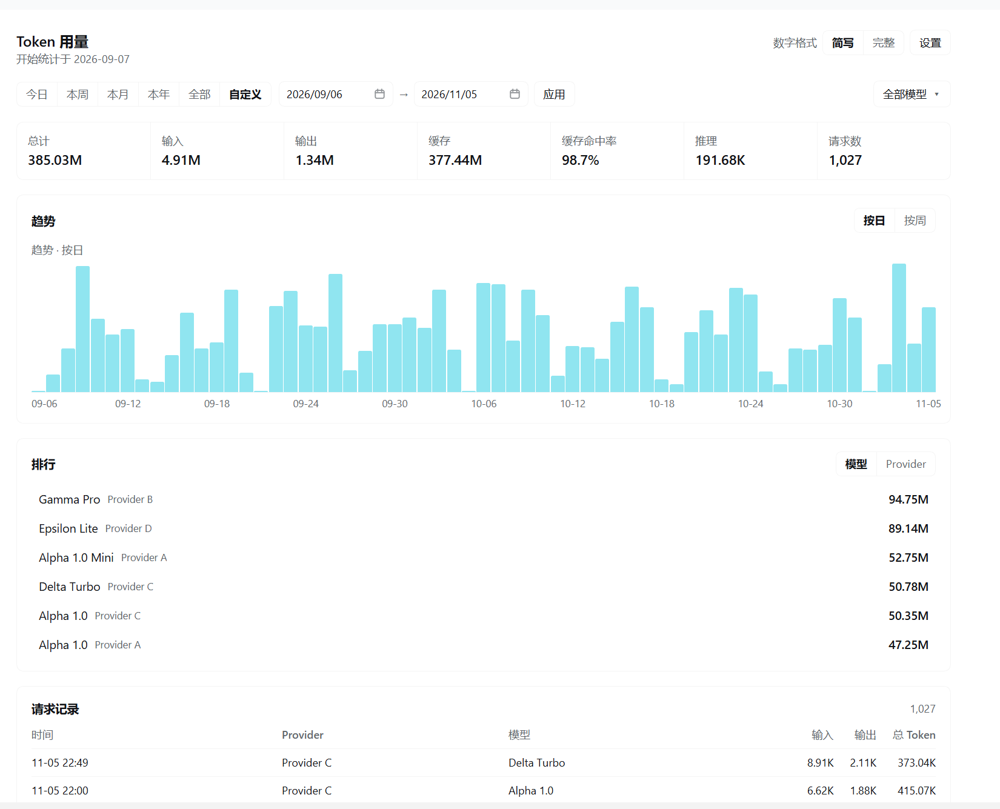
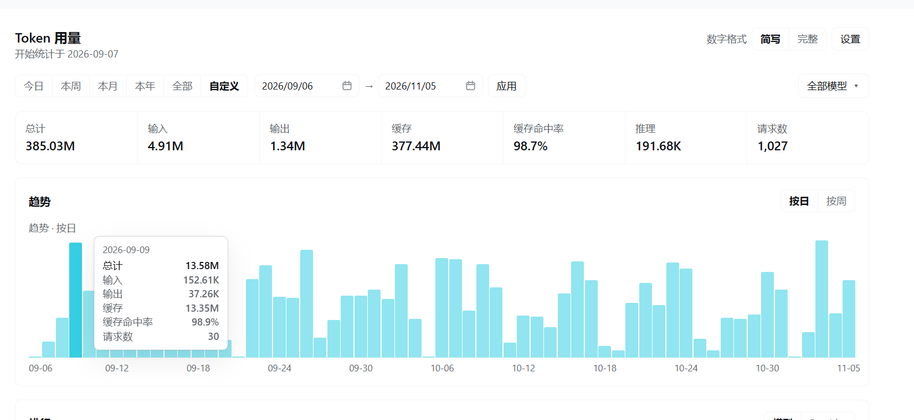
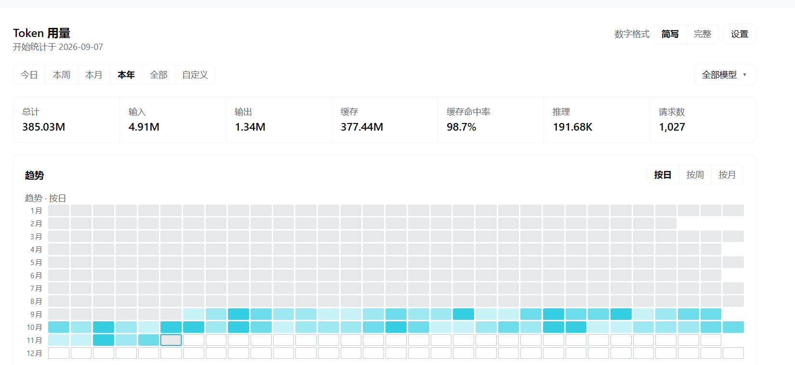
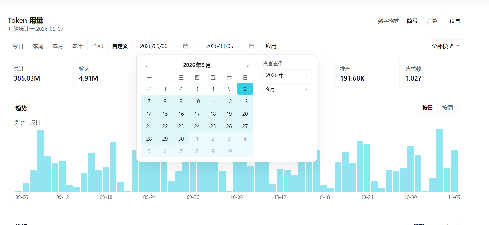

# dsh-token-usage

**简体中文** | [English](README_EN.md)

[](LICENSE)
[](https://github.com/qiz42144-web/dsh-token-usage/stargazers)
[](https://github.com/qiz42144-web/dsh-token-usage/issues)

一个轻量的 DSH（DeepSeek Harness）插件，在本地记录并可视化 AI Token 用量：按 Provider、账号、套餐、模型拆分，支持时间范围、趋势图、排行和请求记录。

它只是一个**被动的观察者**——读取 DSH 本来就会写入的用量元数据，存进本地 SQLite，再用 SQL 聚合。**不调用模型、不联网、不读取提示词、回复正文或 API Key。**



---

## 功能

### 统计范围

| 范围 | 说明 |
|---|---|
| 今日 / 本周 / 本月 / 本年 / 全部 | 按本地日历计算，不是固定 24 小时窗口 |
| 自定义 | 选择开始与结束日期，点「应用」刷新 |

结束日期包含当天完整数据。最后一次选择会被记住。

### 指标卡片

总计、输入、输出、缓存、**缓存命中率**、推理、请求数，共 7 项。

- 缓存命中率 = 缓存读取 ÷（缓存读取 + 未命中输入），按 Token 加权，不是简单平均
- Provider 未上报缓存计数时显示 `—`，而不是 0%
- 推理 Token 是输出的一部分，不会重复计入总计

### 趋势图



- 柱状图，悬停显示该周期的总计、输入、输出、缓存、缓存命中率、请求数
- 粒度随范围自动调整：今日按小时、本周按日、本月按日/周、本年按日/周/月、全部按周/月/年
- 选择「本年 + 按日」时切换为**年度热力图**，12 个月 × 31 天，一眼看出使用密度



### 排行与请求记录

- 排行可在「模型 / Provider」之间切换，按总量降序
- 请求记录按时间倒序，每页 50 条，可「加载更多」
- Provider 未返回 usage 的请求显示「未知」，不会被当成 0

### 筛选与重命名

- 「全部模型」下拉是一棵树：Provider → 账号 → 套餐 → 模型，点任意层级即可筛选
- 支持搜索模型 id 或自定义名称
- 可给 Provider、账号、模型设置显示名，给模型设置套餐标签；**真实 id 始终保留**

### 自定义日期范围



- 点击日期框任意位置展开日历，不调用浏览器原生日期弹窗
- 周一起始，起止日青色高亮，区间用浅青连接
- 右侧「快速选择」可直接跳转年份和月份
- 支持直接键入 `2026-09-06` 或 `2026/09/06`

### 数字格式

「简写」显示 `4.25B`，「完整」显示 `4,254,321,987`，作用于页面所有数字并记住选择。

---

## 安装

插件是一个标准的 DSH bundle。在 DSH 会话中执行：

```
plugin_manager install_bundle  target = <本目录的绝对路径>
```

或者使用 `dsh` CLI：

```
dsh plugin --profile <profile> add <本目录的绝对路径>
```

安装后侧边栏会出现「Token 用量」入口，点开即是完整页面。

> **修改插件源码后需要重启 DSH。** 新安装的 bundle 会立即生效，但改动 Host 模块需要新的模块代次，插件管理器会提示 `restart-required`。

### 卸载

```
plugin_manager remove_bundle  target = dsh-token-usage
```

数据库不会被删除。如需彻底清除历史，请手动删除 `$DSH_HOME/token-usage/`。

### 配置

所有配置项都是可选的，默认 `config: {}`。

| 配置项 | 默认值 | 说明 |
|---|---|---|
| `dbPath` | `$DSH_HOME/token-usage/usage.db` | SQLite 历史文件的绝对路径 |
| `recordAttempts` | `true` | 是否把「完全没有返回消息」的模型步骤也记成一条未知请求 |

```yaml
- insert:
    - id: token-usage
      name: dsh-token-usage
      config:
        dbPath: 'D:/dsh-data/token-usage.db'
        recordAttempts: false
```

---

## 数据存储与隐私

**存什么**

每条模型步骤一行：时间、Provider id、模型 id、输入/输出/缓存/推理 Token、请求数。

**不存什么**

提示词、回复正文、工具参数、请求体、API Key、账号凭据——这些字段根本不会被读取。

**存在哪**

- 数据库：`$DSH_HOME/token-usage/usage.db`（SQLite）
- 偏好设置：同目录下的 `settings.json`（数字格式、上次范围、显示选项）

**会不会联网**

不会。插件没有任何出站请求，唯一的 `fetch` 是前端页面调用本机 Host 的接口。

**会不会消耗额外 Token**

不会。它不调用模型、不注册工具、不往提示词里注入任何内容，因此既不产生请求也不占用上下文。

详见 [docs/隐私与数据说明.md](docs/隐私与数据说明.md)。

---

## 常见问题

**Q：数字和 Provider 后台对不上？**

以 Provider 上报的 `usage` 为准。不同 Provider 对「输入」的定义不同（有的含缓存命中，有的不含），插件按 `总计 = 输入 + 输出 + 缓存读 + 缓存写` 统一换算。

**Q：为什么有些请求显示「未知」？**

Provider 没有返回 usage 字段。这类请求会计入请求数，但不计入 Token 合计，页面上会有提示。

**Q：为什么排行里看不到「未识别」？**

默认隐藏。在「设置」里打开「显示未识别排行项」即可。

**Q：数据会同步到云端吗？**

不会。全部在本机 SQLite 里。

**Q：可以只看某个模型吗？**

可以。点「全部模型」下拉，在树里选中该模型，或直接搜索。

**Q：卸载后数据还在吗？**

在。卸载不会删除数据库。

---

## 开发

```bash
node --test test/*.test.mjs      # 118 个自动化测试
node dev/verify-live.mjs http://127.0.0.1:4551   # 对运行中的实例做 53 项验收
```

- 无第三方运行时依赖，只用 Node 内置的 `node:sqlite`
- 前端是手写的 React 组件，通过 `window.__ModuleLoader__` 注入，不打包
- 测试夹具是**合成数据**，由 `test/build-fixture.mjs` 生成，不含任何真实用量

详见 [docs/开发指南.md](docs/开发指南.md)。

---

## 文档

- [使用指南](docs/使用指南.md)
- [隐私与数据说明](docs/隐私与数据说明.md)
- [开发指南](docs/开发指南.md)
- [测试报告](TEST-REPORT.md)

---

## License

[MIT](LICENSE) © 2026 qiz42144-web
