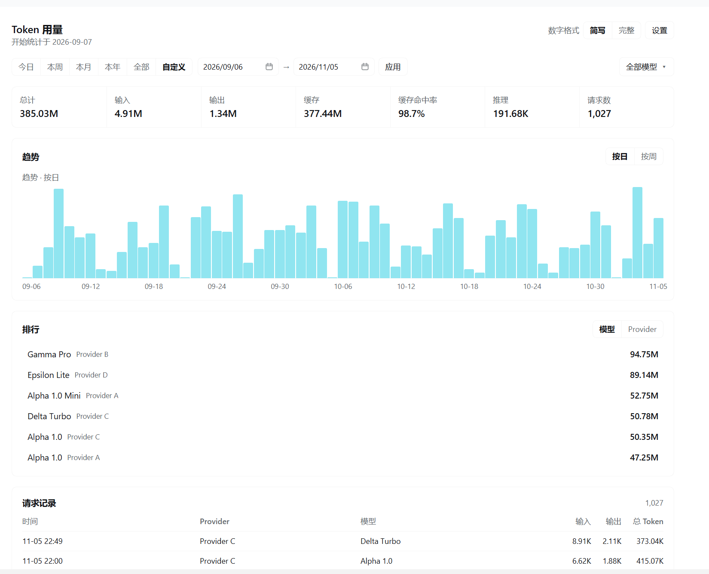
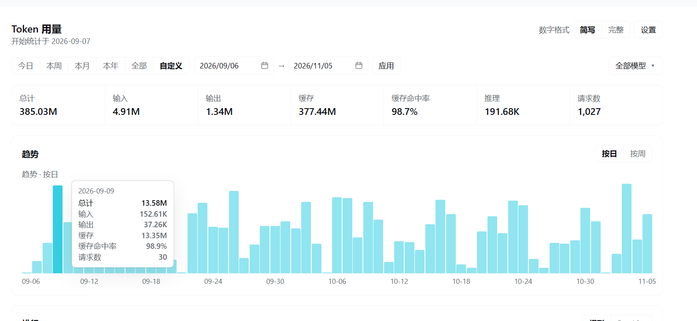
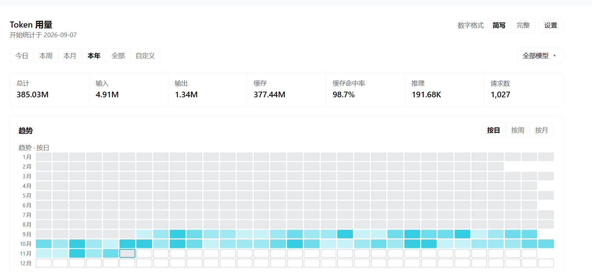
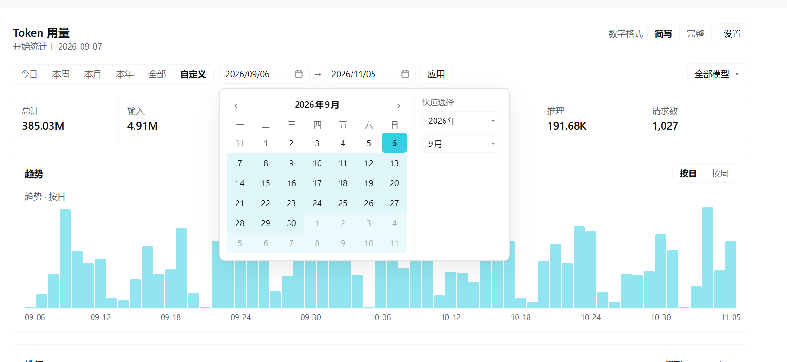

# dsh-token-usage

[简体中文](README.md) | **English**

[](LICENSE)
[](https://www.npmjs.com/package/@aixnest/dsh-token-usage)
[](https://github.com/qiz42144-web/dsh-token-usage/stargazers)
[](https://github.com/qiz42144-web/dsh-token-usage/issues)

A lightweight DSH (DeepSeek Harness) plugin that records and visualises AI token usage locally: split by provider, account, plan and model, with time ranges, trends, rankings and a request log.

It is a **passive observer**. It reads the usage metadata DSH already writes for every model step, stores it in a local SQLite file and aggregates it with SQL. It **never calls a model, never touches the network, and never reads a prompt, a reply or an API key.**



---

## Features

### Time ranges

| Range | Meaning |
|---|---|
| Today / This week / This month / This year / All | Local calendar boundaries, not a rolling 24-hour window |
| Custom | Pick a start and an end date, then press Apply |

The end date includes the whole day. The last choice is remembered.

### Metric cards

Total, input, output, cached, **cache hit rate**, reasoning and request count — seven cards.

- Cache hit rate = cached reads ÷ (cached reads + uncached input), weighted by tokens rather than averaged per request
- Shows `—` instead of 0% when no provider reports cache counters
- Reasoning tokens are part of the output and are never added to the total twice

### Trend chart



- Bar chart; hovering a bar shows that period's total, input, output, cached, cache hit rate and request count
- Granularity follows the range: today by hour, week by day, month by day/week, year by day/week/month, all by week/month/year
- Choosing "This year + by day" switches to a **yearly heatmap**: 12 months × 31 days, so density is visible at a glance



### Rankings and request log

- Rankings switch between model and provider, ordered by total
- The request log is newest first, 50 rows per page, with Load more
- A request whose provider returned no usage shows "unknown" instead of a zero

### Filtering and renaming

- The "All models" dropdown is a tree: provider → account → plan → model; click any level to filter by it
- Search matches raw ids and custom display names
- Providers, accounts and models can be given display names, and models a plan label; **the real id is always kept**

### Custom date range



- Clicking anywhere on a date field opens the calendar; the browser's native date popup is never used
- Monday-first grid, the two ends highlighted in cyan, the days between joined by a soft band
- The "Jump to" panel on the right moves straight to any year or month
- Dates can also be typed directly as `2026-09-06` or `2026/09/06`

### Number format

"Short" shows `4.25B`, "Full" shows `4,254,321,987`. It applies to every number on the page and is remembered.

---

## Install

### From npm (recommended)

Package: **`@aixnest/dsh-token-usage`**
Registry page: https://www.npmjs.com/package/@aixnest/dsh-token-usage

From a DSH session:

```
plugin_manager install_bundle  target = @aixnest/dsh-token-usage
```

### From source

```bash
git clone https://github.com/qiz42144-web/dsh-token-usage.git
```

Then, from a DSH session, point `target` at the cloned directory:

```
plugin_manager install_bundle  target = <absolute path to this directory>
```

### After installing

A "Token usage" entry appears in the sidebar; opening it shows the full page. The database starts empty and fills from the next request onwards.

### Update

Run the same install command again to upgrade:

```
plugin_manager install_bundle  target = @aixnest/dsh-token-usage
```

> **Restart DSH after changing the plugin's own source.** A new version applies immediately; if the update touched the Host half, the plugin manager reports `restart-required` — restart as prompted.

### Uninstall

```
plugin_manager remove_bundle  target = @aixnest/dsh-token-usage
```

For a source install, pass the directory path instead: `plugin_manager remove_bundle  target = <absolute path to this directory>`.

The database is not deleted. Remove `$DSH_HOME/token-usage/` yourself if you want the history gone.

### Troubleshooting

**No sidebar entry after installing**

Check that the install reported `applied` rather than `restart-required`; the latter needs a DSH restart.

**"Cannot find module `@aixnest/dsh-token-usage`"**

The profile's `node_modules` does not contain the package. Run the install command again, or check the profile's `package.json` for the dependency.

**The page opens but stays empty**

There is no data yet. The plugin records only requests made after installation; it does not backfill history.

**I want the database somewhere else**

Add `dbPath` to the `token-usage` entry in the profile config, as shown under Configuration.

### Configuration

Every key is optional; the patch ships `config: {}`.

| Key | Default | Meaning |
|---|---|---|
| `dbPath` | `$DSH_HOME/token-usage/usage.db` | Absolute path of the SQLite history file |
| `recordAttempts` | `true` | Also record a model step that returned no message at all as an unknown request row |

```yaml
- insert:
    - id: token-usage
      name: dsh-token-usage
      config:
        dbPath: 'D:/dsh-data/token-usage.db'
        recordAttempts: false
```

---

## Storage and privacy

**What is stored**

One row per model step: time, provider id, model id, input/output/cached/reasoning tokens and the request count.

**What is not stored**

Prompts, replies, tool arguments, request bodies, API keys, account credentials — those fields are never read in the first place.

**Where it lives**

- Database: `$DSH_HOME/token-usage/usage.db` (SQLite)
- Preferences: `settings.json` in the same directory (number format, last range, display options)

**Does it phone home**

No. The plugin makes no outbound request; the only `fetch` is the page calling its own local Host endpoint.

**Does it cost extra tokens**

No. It does not call a model, register a tool, or inject anything into a prompt, so it neither creates requests nor consumes context.

See [docs/隐私与数据说明.md](docs/隐私与数据说明.md) for the full detail (in Chinese).

---

## FAQ

**The numbers do not match my provider dashboard.**

The provider-reported `usage` is authoritative. Providers disagree on what "input" includes (some fold in cache hits, some do not); the plugin normalises everything to `total = input + output + cache read + cache write`.

**Why do some requests show "unknown"?**

The provider returned no usage field. Those requests count towards the request total but not towards the token total, and the page says so.

**Why is the "unidentified" row missing from the rankings?**

It is hidden by default. Turn on "Show unidentified ranking row" in Settings.

**Is anything synced to the cloud?**

No. Everything stays in the local SQLite file.

**Can I look at a single model?**

Yes. Open the "All models" dropdown and pick it from the tree, or search for it.

**Does uninstalling delete my history?**

No. Uninstalling leaves the database in place.

---

## Development

```bash
node --test test/*.test.mjs                      # 118 automated tests
node dev/verify-live.mjs http://127.0.0.1:4551   # 53 live checks against a running instance
```

- No third-party runtime dependency; only Node's built-in `node:sqlite`
- The client is hand-written React injected through `window.__ModuleLoader__`, with no bundler
- The test fixture is **synthetic**, generated by `test/build-fixture.mjs`, and contains no real usage

See [docs/开发指南.md](docs/开发指南.md) for the full detail (in Chinese).

---

## Documentation

- [User guide](docs/使用指南.md) (Chinese)
- [Privacy and data](docs/隐私与数据说明.md) (Chinese)
- [Development guide](docs/开发指南.md) (Chinese)
- [Test report](TEST-REPORT.md)

---

## License

[MIT](LICENSE) © 2026 qiz42144-web
